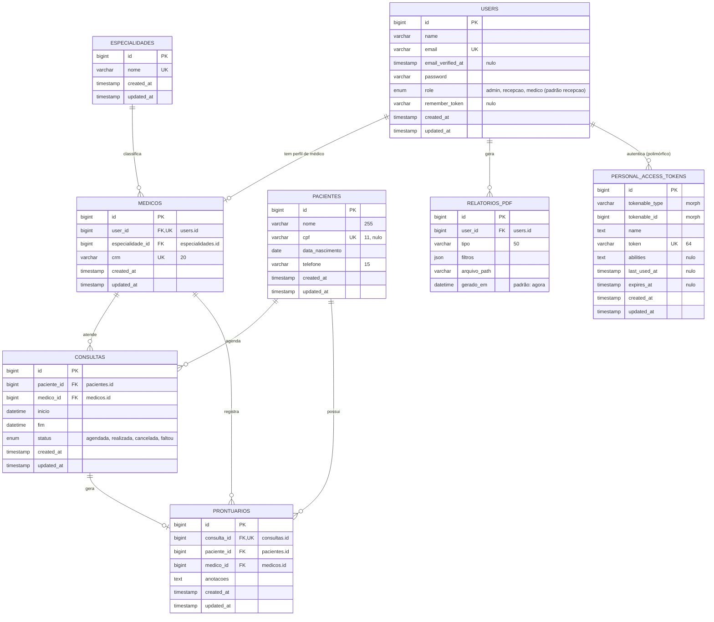
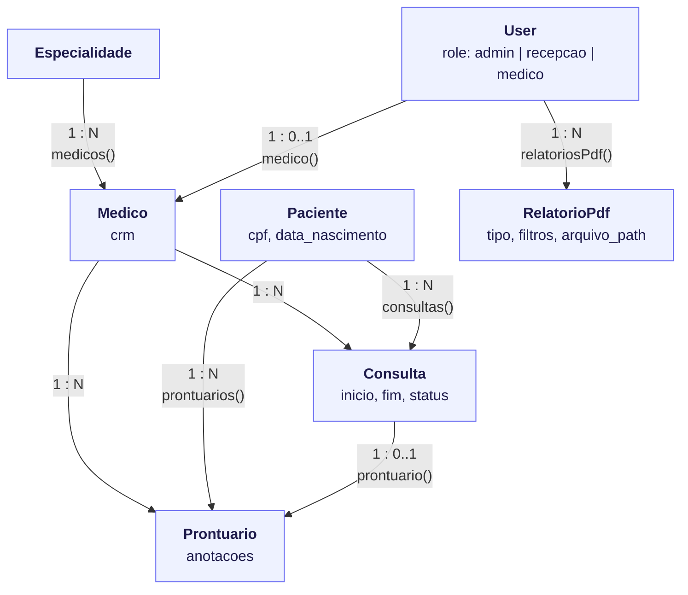

<p align="center">
  
</p>

<h1 align="center">CliniGo</h1>

##  Sobre o projeto
 
O ClinicGo organiza o fluxo de uma clínica em uma API versionada (`/api/v1`). Ele cobre o cadastro de pacientes e médicos, o agendamento de consultas, o registro de prontuários e a geração de relatórios em PDF, com acesso protegido por autenticação.
 
##  Status
 
| Item | Situação |
|---|---|
| Versão atual | **v0.3.0** — autenticação e segurança da API |
| Autenticação (login/logout com Sanctum) | ✅ Concluído |
| Models, migrations, factories e seeders | ✅ Concluído |
| CRUD de pacientes | ✅ Concluído |
| Mensagens em português (pt-BR) | ✅ Concluído |
| Demais CRUDs, autorização por perfil e relatórios | 🔜 Em andamento (veja o [Roadmap](#-roadmap)) |
 
#  Banco de dados — ClinicGo

Documentação do banco (MySQL) gerada a partir das migrations e dos models do projeto. Os diagramas usam [Mermaid](https://mermaid.js.org/) e são renderizados direto no GitHub.

## 1. Diagrama do banco (DER)

Tabelas, colunas, chaves primárias (**PK**), chaves estrangeiras (**FK**) e restrições únicas (**UK**).



> Todas as chaves estrangeiras usam `restrictOnDelete`: não é possível excluir um registro que ainda tem dependentes (ex.: um paciente com consultas).
> O Laravel também cria as tabelas padrão `sessions`, `password_reset_tokens`, `cache` e `jobs`, que ficam fora do diagrama por não fazerem parte do domínio.

## 2. Relacionamentos entre as entidades

Visão dos models Eloquent, com a cardinalidade e o método de cada relacionamento.



### Regras de relacionamento

| Relação | Cardinalidade | Regra |
|---|---|---|
| User → Medico | 1 : 0..1 | `medicos.user_id` é único: cada usuário tem no máximo um perfil de médico |
| Especialidade → Medico | 1 : N | Todo médico tem exatamente uma especialidade |
| Paciente → Consulta | 1 : N | Um paciente pode ter várias consultas |
| Medico → Consulta | 1 : N | Um médico atende várias consultas (índice em `medico_id, inicio, fim`) |
| Consulta → Prontuario | 1 : 0..1 | `prontuarios.consulta_id` é único: no máximo um prontuário por consulta |
| Paciente / Medico → Prontuario | 1 : N | O prontuário também guarda o paciente e o médico |
| User → RelatorioPdf | 1 : N | Cada relatório registra quem o gerou |
| User → PersonalAccessToken | 1 : N | Relacionamento polimórfico (`tokenable`) criado pelo Sanctum |

## 3. Pontos de atenção

- **Prontuário e consulta:** `paciente_id` e `medico_id` do prontuário repetem dados que já existem na consulta. Vale validar na API que eles coincidem com os da consulta.
- **Conflito de horários:** o banco só tem um índice em `consultas`. A regra "um médico não pode ter duas consultas sobrepostas" precisa ser validada na aplicação.
- **Perfis de acesso:** `users.role` aceita `admin`, `recepcao` e `medico`. Pacientes não têm usuário, então a autorização deve usar esses três perfis.
- **Relacionamentos inversos ausentes:** os models `Medico` (`user()`, `consultas()`, `prontuarios()`) ainda não declaram esses métodos, apesar de o banco já permitir.

##  Roadmap
 
- [x] Models, migrations, factories e seeders
- [x] Autenticação com Sanctum (login e logout)
- [x] CRUD de pacientes
- [x] Traduções em pt-BR
- [ ] Autorização por perfil (admin, médico, paciente) com Policies
- [ ] CRUDs de médicos, especialidades, consultas e prontuários
- [ ] Regras de agendamento (sem conflito de horário, data futura, status da consulta)
- [ ] Relatórios em PDF
- [ ] Rate limiting no login, CORS e tratamento padronizado de erros
- [ ] Testes automatizados (Feature tests)
- [ ] Documentação da API (Scribe ou Swagger)
- [ ] Front-end consumindo a API
##  POO aplicada ao projeto
 
O ClinicGo também serve como laboratório de **Programação Orientada a Objetos**, com base no curso [POO com Java 25 LTS](https://github.com/adrianohmf/POO-com-Java-25LTS). Os conceitos são aplicados em PHP/Laravel e, futuramente, em um serviço Java para relatórios.
 
| Conceito | Aplicação no ClinicGo |
|---|---|
| **Classes e objetos** | `Paciente`, `Medico` e `Consulta` modelam o domínio. Factories e seeders criam vários objetos. |
| **Atributos e métodos** | Métodos como `cancelar()` na consulta e constantes para os status. |
| **Construtores** | *Constructor promotion* em DTOs e Services (PHP); `records` para DTOs no serviço Java. |
| **Encapsulamento** | `$fillable` e `$hidden` nos models, *accessors/mutators* e visibilidade `private`/`protected` nas Services. |
| **Herança** | Comparação entre composição (`User` com `Medico`) e herança (`Usuario` → `Medico`, `Paciente`). |
| **Polimorfismo** | Notificações (e-mail, SMS, WhatsApp) com a mesma chamada e implementações diferentes. |
| **Classes abstratas e interfaces** | `RelatorioGenerator` com `PdfRelatorio` e `CsvRelatorio`; `ConsultaRepositoryInterface`. |
| **Coleções (ArrayList)** | `Collection` do Laravel para filtrar e ordenar a agenda. |
| **HashSet e HashMap** | Horários ocupados sem repetição e agrupamento de consultas por especialidade nos relatórios. |
 
### Ideia futura: serviço de relatórios em Java
 
Um microsserviço **Spring Boot** (`relatorios-service`) que consome a API com o token do Sanctum e gera os PDFs, usando interfaces e polimorfismo:
 
```java
public interface RelatorioGenerator {
    byte[] gerar(List<Consulta> consultas);
}
 
public class PdfRelatorio implements RelatorioGenerator { /* ... */ }
public class CsvRelatorio implements RelatorioGenerator { /* ... */ }
```
 ## Aviso
 
Todos os dados são fictícios (Faker). Este é um MVP de estudo e não deve ser usado com dados reais de pacientes. Dados pessoais e de saúde são sensíveis pela LGPD: num sistema real, esses campos teriam criptografia e controle de acesso rigoroso.

##  Autora
 
**Karolayne Firmino**
[LinkedIn](https://www.linkedin.com/in/karolayne-firmino) · [GitHub](https://github.com/Firmino03)
 
