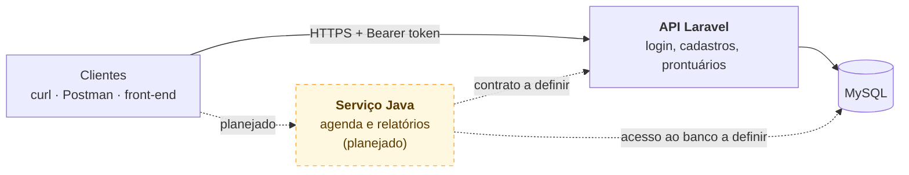
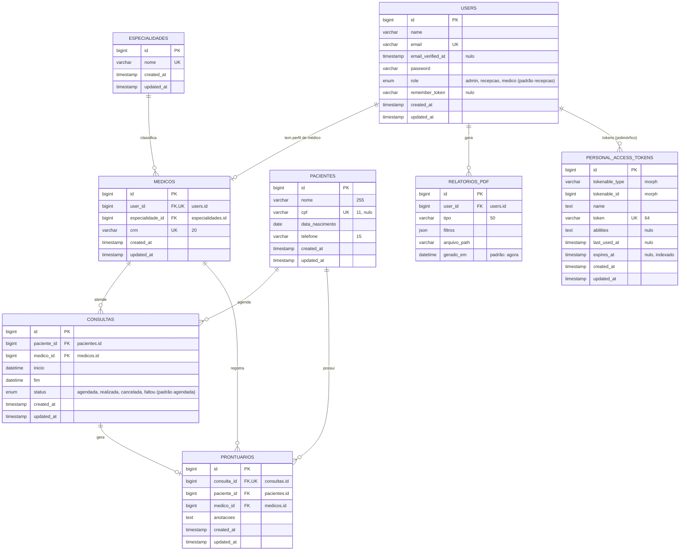
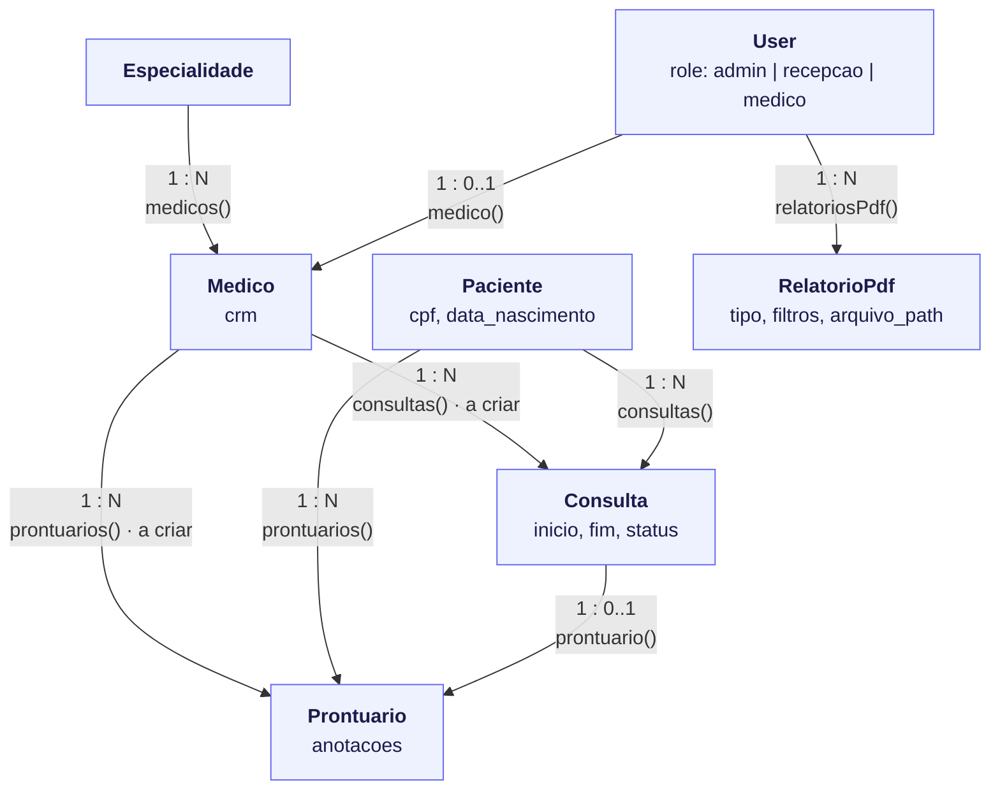

<p align="center">
  
</p>

<h1 align="center">CliniGo</h1>

## Sobre o projeto

O CliniGo organiza o fluxo de uma clínica em uma API versionada (`/api/v1`). Ele cobre o cadastro de pacientes e médicos, o agendamento de consultas, o registro de prontuários e a geração de relatórios em PDF, com acesso protegido por autenticação.

É um projeto de estudo, feito para praticar uma arquitetura próxima da de uma empresa: **Laravel (PHP)** e **MySQL** hoje, e um **serviço em Java** planejado para o domínio de agenda e para os relatórios.

## Status

| Item | Situação |
|---|---|
| Versão atual | **v0.4.1**: CRUD de pacientes e testes automatizados |
| Autenticação (login/logout com Sanctum) | ✅ Concluído |
| Models, migrations, factories e seeders | ✅ Concluído |
| CRUD de pacientes | ✅ Concluído |
| Testes automatizados de autenticação e pacientes (17 testes) | ✅ Concluído |
| Mensagens em português (pt-BR) | ✅ Concluído |
| Demais CRUDs (especialidades, médicos, prontuários) | 🔜 Próximo |
| Autorização por perfil (Policies) | 🔜 Planejado |
| Serviço Java (agenda, regra de conflito e relatórios em PDF) | 🔜 Planejado |

## Arquitetura



| Parte | Responsabilidade | Situação |
|---|---|---|
| **Laravel** | Login e tokens, usuários, pacientes, médicos, especialidades, prontuários | Em uso |
| **MySQL** | Banco único; a integridade (chaves estrangeiras e únicos) é garantida nele | Em uso |
| **Serviço Java** | Domínio de agenda (consultas, conflito de horário, status) e relatórios em PDF | Planejado |

> O contrato entre Laravel e Java (autenticação do token, quem grava em `consultas`) e a tecnologia do serviço (Java puro ou Spring Boot) ainda serão definidos.

## API

Todas as rotas ficam sob `/api/v1`. Envie sempre o header `Accept: application/json`.

| Método | Rota | Acesso | Resposta |
|---|---|---|---|
| POST | `/login` | público | 200 com `token` e `user`; 401 se as credenciais forem inválidas; 422 se faltar dado |
| POST | `/logout` | token | 200; apaga o token usado |
| GET | `/me` | token | 200 com o usuário do token |
| GET | `/pacientes?busca=` | token | 200, lista paginada (15 por página) com busca por nome |
| POST | `/pacientes` | token | 201; 422 se a validação falhar |
| GET | `/pacientes/{id}` | token | 200 |
| PUT/PATCH | `/pacientes/{id}` | token | 200; 422 se a validação falhar |
| DELETE | `/pacientes/{id}` | token | 204; 409 se o paciente tiver consultas ou prontuários |

Sem token, as rotas protegidas respondem 401.

## Como executar

Requisitos: PHP 8.3+, Composer e MySQL.

```bash
git clone https://github.com/Firmino03/CliniGo.git
cd CliniGo/laravel-app

composer install
cp .env.example .env
php artisan key:generate

# crie o banco "clinigo" no MySQL e confira as variáveis DB_* no .env
php artisan migrate --seed
php artisan serve
```

O seed cria as especialidades, um administrador (`admin@clinigo.test`, senha `password`, **apenas para desenvolvimento**), 30 pacientes e 10 médicos fictícios.

```bash
curl -X POST http://localhost:8000/api/v1/login \
  -H "Accept: application/json" -H "Content-Type: application/json" \
  -d '{"email":"admin@clinigo.test","password":"password"}'
```

### Testes

```bash
php artisan test
```

Os testes usam SQLite em memória (precisa da extensão `pdo_sqlite`) e não tocam o MySQL.

# Banco de dados

Documentação do banco (MySQL) gerada a partir das migrations e dos models do projeto. Os diagramas usam [Mermaid](https://mermaid.js.org/) e são renderizados direto no GitHub.

## 1. Diagrama do banco (DER)

Tabelas, colunas, chaves primárias (**PK**), chaves estrangeiras (**FK**) e restrições únicas (**UK**).



**Regras do banco**

- Todas as chaves estrangeiras do domínio usam `restrictOnDelete`: não é possível excluir um registro que ainda tem dependentes (ex.: um paciente com consultas).
- `consultas` tem um índice composto em `(medico_id, inicio, fim)`, que acelera a busca da agenda de um médico.
- `relatorios_pdf` não tem `created_at` nem `updated_at`: a data de geração fica em `gerado_em`.
- O Laravel também cria as tabelas `sessions`, `password_reset_tokens`, `cache` e `jobs`, que ficam fora do diagrama por não fazerem parte do domínio.

## 2. Relacionamentos entre as entidades

Visão dos models Eloquent, com a cardinalidade e o método de cada relacionamento. Onde aparece **a criar**, o relacionamento já existe no banco, mas o método ainda não foi declarado no model.



### Regras de relacionamento

| Relação | Cardinalidade | Métodos nos models | Regra no banco |
|---|---|---|---|
| User → Medico | 1 : 0..1 | `User::medico()` ✅ · `Medico::user()` 🔜 | `medicos.user_id` é único: cada usuário tem no máximo um perfil de médico |
| Especialidade → Medico | 1 : N | `Especialidade::medicos()` ✅ · `Medico::especialidade()` ✅ | Todo médico tem exatamente uma especialidade |
| Paciente → Consulta | 1 : N | `Paciente::consultas()` ✅ · `Consulta::paciente()` ✅ | Um paciente pode ter várias consultas |
| Medico → Consulta | 1 : N | `Medico::consultas()` 🔜 · `Consulta::medico()` ✅ | Índice em `(medico_id, inicio, fim)` |
| Consulta → Prontuario | 1 : 0..1 | `Consulta::prontuario()` ✅ · `Prontuario::consulta()` ✅ | `prontuarios.consulta_id` é único: no máximo um prontuário por consulta |
| Paciente → Prontuario | 1 : N | `Paciente::prontuarios()` ✅ · `Prontuario::paciente()` ✅ | O prontuário guarda o paciente |
| Medico → Prontuario | 1 : N | `Medico::prontuarios()` 🔜 · `Prontuario::medico()` ✅ | O prontuário guarda o médico |
| User → RelatorioPdf | 1 : N | `User::relatoriosPdf()` ✅ · `RelatorioPdf::user()` ✅ | Cada relatório registra quem o gerou |
| User → PersonalAccessToken | 1 : N (polimórfico) | `User::tokens()` ✅ (trait `HasApiTokens`) | `tokenable_type` e `tokenable_id`, criados pelo Sanctum |

✅ já existe · 🔜 a criar

## 3. Pontos de atenção

- **Prontuário e consulta:** `paciente_id` e `medico_id` do prontuário repetem dados que já existem na consulta. Vale validar na API que eles coincidem com os da consulta.
- **Conflito de horários:** o banco só tem um índice em `consultas`. A regra "um médico não pode ter duas consultas sobrepostas" precisa ser validada na aplicação (planejada no serviço de agenda). A verificação deve comparar **intervalos** (`novo.inicio < existente.fim` e `novo.fim > existente.inicio`), e não apenas horários de início iguais.
- **Perfis de acesso:** `users.role` aceita `admin`, `recepcao` e `medico`. Hoje só o médico tem vínculo com `users` (`medicos.user_id`); o paciente é um cadastro feito pela equipe, sem login. Se um dia houver portal do paciente, o caminho é uma coluna `pacientes.user_id` opcional (nullable). Decisão ainda em aberto.
- **Relacionamentos inversos ausentes:** o model `Medico` ainda não declara `user()`, `consultas()` e `prontuarios()`, apesar de o banco já permitir.
- **Autorização:** hoje qualquer usuário autenticado acessa os pacientes. As Policies por perfil são uma etapa à parte.
- **Tokens:** `config/sanctum.php` está com `expiration` nulo, ou seja, os tokens não expiram. Também não há limite de tentativas no login.
- **Dados sensíveis:** a API devolve o CPF completo e valida apenas o formato (11 dígitos), sem conferir os dígitos verificadores.

## Roadmap

- [x] Models, migrations, factories e seeders
- [x] Autenticação com Sanctum (login e logout)
- [x] CRUD de pacientes
- [x] Traduções em pt-BR
- [x] Testes automatizados de autenticação e pacientes
- [ ] CRUDs de especialidades, médicos e prontuários (Laravel)
- [ ] Autorização por perfil (admin, recepção, médico) com Policies
- [ ] Serviço Java: agenda e consultas com regra de conflito de horário
- [ ] Integração Laravel e Java (contrato da API)
- [ ] Relatórios em PDF no serviço Java
- [ ] Rate limiting no login, expiração de tokens, CORS e tratamento padronizado de erros
- [ ] Testes automatizados dos demais recursos
- [ ] Documentação da API (Scribe ou Swagger)
- [ ] Front-end consumindo a API

## POO aplicada ao projeto

O CliniGo também serve como laboratório de **Programação Orientada a Objetos**, com base no curso [POO com Java 25 LTS](https://github.com/adrianohmf/POO-com-Java-25LTS). A regra é aplicar cada conceito onde ele resolve um problema real do domínio, sem forçar. O Laravel cuida de cadastros e autenticação; o serviço Java, que concentra a agenda e os relatórios, é onde a maior parte desses conceitos aparece.

| Conceito | Aplicação no CliniGo | Situação |
|---|---|---|
| **Classes e objetos** | `Paciente`, `Medico` e `Consulta` modelam o domínio (Eloquent). Factories e seeders criam vários objetos de uma vez. No Java: `Consulta`, `Agenda`. | ✅ PHP · 🔜 Java |
| **Atributos e métodos** | Enum `StatusConsulta`, método `consulta.cancelar()` e sobrecarga de `agendar(Consulta)` e `agendar(Paciente, Medico, LocalDateTime)` (a sobrecarga existe em Java, não em PHP). | 🔜 Java |
| **Construtores** | `record Periodo(inicio, fim)` que valida `fim > inicio` e `records` para DTOs no Java; *constructor promotion* em classes PHP quando houver DTOs. | 🔜 |
| **Encapsulamento** | `#[Fillable]` e `#[Hidden]` no `User` (a senha nunca sai na resposta). No Java, o `status` da consulta é `private` e só muda por métodos. Planejado: *accessors* para telefone e CPF e Policy para o prontuário. | ✅ parcial · 🔜 |
| **Herança** | Decisão: `User` se relaciona com `Medico` por **composição** ("tem-um"), não por herança. A herança entra onde há "é-um": exceções de negócio e `RelatorioBase` (Template Method). | ✅ decisão · 🔜 Java |
| **Polimorfismo** | `RelatorioGenerator` com `PdfRelatorio` e `CsvRelatorio`: mesma chamada, comportamentos diferentes. | 🔜 Java |
| **Classes abstratas e interfaces** | `RelatorioGenerator` (interface), `RelatorioBase` (classe abstrata) e `ConsultaRepository` (interface), com implementação em memória para testes e outra com JDBC. | 🔜 Java |
| **Coleções (ArrayList)** | `List<Consulta>` na agenda do médico; no Laravel, as listagens paginadas usam `Collection`. | 🔜 |
| **HashSet e HashMap** | `Map<Long, List<Consulta>>` para agrupar a agenda por médico e `Map` para contar consultas por status nos relatórios. | 🔜 Java |

### Composição ou herança: `User` e `Medico`

| Aspecto | Composição (escolhida) | Herança `Usuario` → `Medico` |
|---|---|---|
| Relação | "tem-um": o médico tem um usuário de acesso | "é-um": o médico é um tipo de usuário |
| No banco | tabelas separadas, chave estrangeira única | tabela única com coluna de tipo, ou tabelas ligadas por join |
| Mudar de papel | altera o perfil (`users.role`) | exige recriar o objeto |
| No Eloquent | natural (`hasOne` / `belongsTo`) | não é nativo |

Em Java puro, uma hierarquia `Usuario` → `Medico`, `Paciente`, `Admin` funcionaria bem. Aqui a composição foi escolhida pela flexibilidade do banco e do Eloquent.

### Serviço Java (planejado)

Um serviço separado, dono do domínio de agenda. Responsabilidades previstas:

- consultas e seu ciclo de vida (`agendada`, `realizada`, `cancelada`, `faltou`);
- regra de conflito de horário entre consultas do mesmo médico;
- geração de relatórios em PDF.

Ainda a definir: Java puro ou Spring Boot, o contrato com a API Laravel e como o serviço acessa os dados. Dois exemplos do tipo de código previsto:

```java
// Regra de conflito: dois períodos se sobrepõem?
public record Periodo(LocalDateTime inicio, LocalDateTime fim) {
    public Periodo {
        if (!fim.isAfter(inicio)) {
            throw new IllegalArgumentException("O fim deve ser depois do início");
        }
    }

    public boolean sobrepoe(Periodo outro) {
        return inicio.isBefore(outro.fim()) && fim.isAfter(outro.inicio());
    }
}

// Polimorfismo: a mesma chamada gera formatos diferentes
public interface RelatorioGenerator {
    byte[] gerar(List<Consulta> consultas);
}

public class PdfRelatorio implements RelatorioGenerator { /* ... */ }
public class CsvRelatorio implements RelatorioGenerator { /* ... */ }
```

## Aviso

Todos os dados são fictícios (Faker). Este é um MVP de estudo e não deve ser usado com dados reais de pacientes. Dados pessoais e de saúde são sensíveis pela LGPD: num sistema real, esses campos teriam criptografia e controle de acesso rigoroso.

## Autora

**Karolayne Firmino**
[LinkedIn](https://www.linkedin.com/in/karolayne-firmino) · [GitHub](https://github.com/Firmino03)
