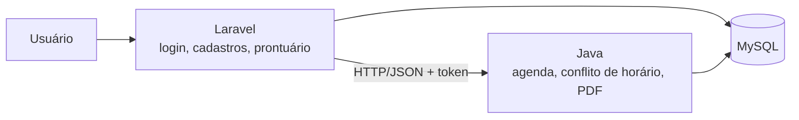
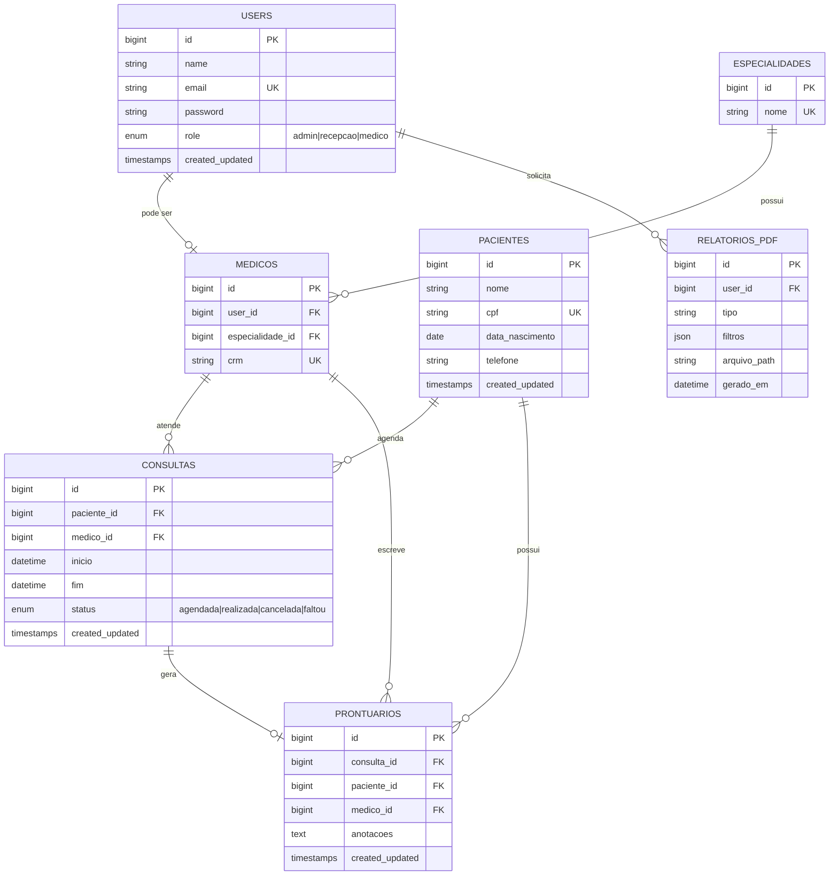

  

<h1 align="center">CliniGo</h1>

Sistema de gestão ambulatorial para clínicas de pequeno porte. Projeto de portfólio que simula uma arquitetura real de empresa: um portal em Laravel integrado a um serviço Java independente.

## O que faz

- Autenticação com papéis: admin, recepção e médico
- Cadastro de pacientes, médicos e especialidades
- Prontuário por consulta, com acesso restrito ao médico responsável
- **Agendamento de consultas com validação de conflito de horário (serviço Java)**
- **Consulta de horários livres por médico (serviço Java)**
- **Relatórios em PDF (serviço Java)**

## Stack

| Camada | Tecnologia |
|---|---|
| Portal web, autenticação e cadastros | Laravel (PHP) |
| Serviço de agenda e relatórios | Java puro + JDBC + OpenPDF |
| Banco de dados | MySQL |
| Infra | Docker Compose |

## Arquitetura

Cada serviço é dono do seu domínio:

| | Laravel | Java |
|---|---|---|
| Tabelas | `users`, `pacientes`, `medicos`, `especialidades`, `prontuarios` | `consultas`, `relatorios_pdf` |
| Responsabilidade | Autenticação, permissões, telas, CRUDs | Agendamento, regra de conflito, horários livres, PDFs |

O Laravel autentica o usuário e chama o serviço Java por HTTP. O Java não é exposto externamente.

## Decisões de arquitetura

- **Schema versionado só no Laravel.** As migrations criam todas as tabelas, inclusive `consultas`. O Java usa o schema, não o altera.
- **Banco compartilhado.** Simplifica o projeto, mas acopla os serviços (`consultas` tem chaves estrangeiras para tabelas do Laravel). Em produção real, cada serviço teria seu próprio banco.
- **Conflito de horário tratado no Java**, dentro de uma transação com bloqueio, para evitar dois agendamentos simultâneos no mesmo horário.

## Diagrama do banco

## Aviso

Todos os dados são fictícios (Faker). Este é um MVP de estudo e não deve ser usado com dados reais de pacientes. Dados pessoais e de saúde são sensíveis pela LGPD: num sistema real, esses campos teriam criptografia e controle de acesso rigoroso.