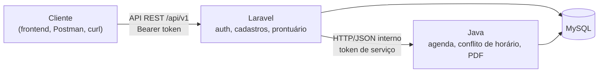
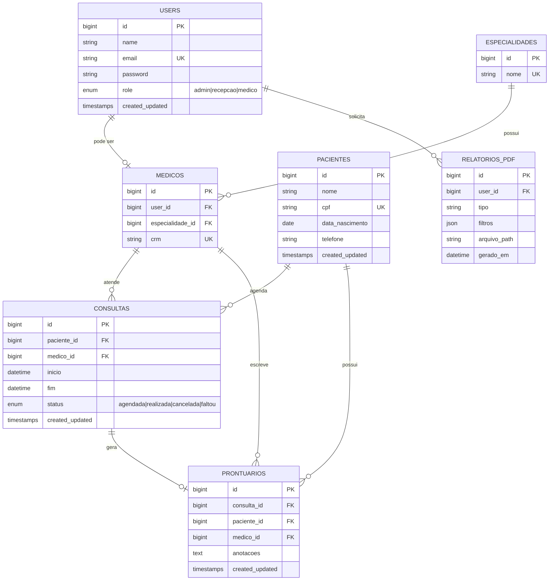

<p align="center">
  
</p>

<h1 align="center">CliniGo</h1>

Sistema de gestão ambulatorial para clínicas de pequeno porte. Projeto de portfólio que simula uma arquitetura real de empresa: uma **API REST em Laravel** integrada a um **serviço Java independente**.

## O que faz

- Autenticação por token, com papéis: admin, recepção e médico
- Cadastro de pacientes, médicos e especialidades
- Prontuário por consulta, com acesso restrito ao médico responsável
- **API REST versionada e documentada (Laravel)**
- **Agendamento de consultas com validação de conflito de horário (serviço Java)**
- **Consulta de horários livres por médico (serviço Java)**
- **Relatórios em PDF (serviço Java)**

## Stack

| Camada | Tecnologia |
|---|---|
| API REST, autenticação e cadastros | Laravel (PHP) + Sanctum |
| Serviço de agenda e relatórios | Java puro + JDBC + OpenPDF |
| Banco de dados | MySQL |
| Infra | Docker Compose (planejado) |

## Arquitetura



Existem **duas APIs REST**, com papéis diferentes:

| | API do Laravel | API do Java |
|---|---|---|
| Exposição | Pública (para clientes) | Interna (só o Laravel acessa) |
| Autenticação | Token do usuário (Sanctum) | Token de serviço compartilhado |
| Responsabilidade | Autenticação, permissões por papel, CRUDs, prontuário | Agendamento, regra de conflito, horários livres, PDFs |
| Tabelas que escreve | `users`, `pacientes`, `medicos`, `especialidades`, `prontuarios` | `consultas`, `relatorios_pdf` |

O cliente conversa **somente com o Laravel**. Quando o pedido envolve agenda ou PDF, o Laravel valida o usuário e o papel dele e repassa a chamada ao serviço Java.

## API REST

> **Status:** em desenvolvimento. O contrato abaixo é o planejado e será ajustado conforme a implementação.

### Por que uma API REST

A API é o contrato entre o backend e qualquer cliente. Com ela, o mesmo backend atende um frontend web, um app ou um teste via `curl`, sem mudar nada no servidor. Cada recurso (paciente, consulta, prontuário) tem uma URL própria, e o verbo HTTP diz a ação: `GET` lê, `POST` cria, `PUT` atualiza, `DELETE` remove. O servidor não guarda sessão: cada requisição carrega seu próprio token.

### Convenções

- **Versionamento:** todas as rotas começam com `/api/v1`, para evoluir o contrato sem quebrar clientes antigos.
- **Autenticação:** `Authorization: Bearer <token>`, obtido em `POST /api/v1/login` (Laravel Sanctum).
- **Autorização:** Policies do Laravel aplicam as regras por papel. Exemplo: o médico só acessa prontuários e pacientes que atendeu.
- **Validação:** Form Requests validam a entrada, inclusive o dígito verificador do CPF.
- **Saída:** API Resources controlam o JSON devolvido, sem expor colunas desnecessárias.

### Códigos de resposta

| Código | Significado |
|---|---|
| 200 / 201 | Sucesso / recurso criado |
| 401 | Não autenticado (token ausente ou inválido) |
| 403 | Autenticado, mas sem permissão para o recurso |
| 404 | Recurso não encontrado |
| 409 | Conflito (ex.: horário já ocupado) |
| 422 | Dados inválidos (erros de validação) |

### Endpoints planejados

| Método | Rota | Descrição | Papéis |
|---|---|---|---|
| POST | `/api/v1/login` | Gera o token de acesso | Público |
| POST | `/api/v1/logout` | Revoga o token atual | Autenticado |
| GET, POST | `/api/v1/pacientes` | Lista e cadastra pacientes | Admin, recepção |
| GET, PUT | `/api/v1/pacientes/{id}` | Consulta e atualiza um paciente | Admin, recepção |
| GET | `/api/v1/medicos` | Lista médicos | Autenticado |
| GET | `/api/v1/especialidades` | Lista especialidades | Autenticado |
| GET | `/api/v1/medicos/{id}/horarios-livres` | Horários livres do médico *(Java)* | Admin, recepção |
| POST | `/api/v1/consultas` | Agenda uma consulta *(Java)* | Admin, recepção |
| PATCH | `/api/v1/consultas/{id}/status` | Cancela, realiza ou marca falta *(Java)* | Admin, recepção, médico |
| GET, POST | `/api/v1/prontuarios` | Lista e cria prontuários | Médico responsável |
| POST | `/api/v1/relatorios/consultas` | Gera relatório em PDF *(Java)* | Admin |

### Exemplo: agendar uma consulta

Requisição:

```http
POST /api/v1/consultas
Authorization: Bearer <token>
Content-Type: application/json

{
  "paciente_id": 12,
  "medico_id": 3,
  "inicio": "2026-11-10 09:00:00",
  "fim": "2026-11-10 09:30:00"
}
```

Resposta de sucesso (`201`):

```json
{
  "data": {
    "id": 87,
    "paciente_id": 12,
    "medico_id": 3,
    "inicio": "2026-11-10 09:00:00",
    "fim": "2026-11-10 09:30:00",
    "status": "agendada"
  }
}
```

Resposta quando o horário já está ocupado (`409`):

```json
{
  "message": "O médico já possui uma consulta neste horário."
}
```

### Fluxo de uma chamada

1. O cliente envia a requisição ao Laravel com o token do usuário.
2. O Laravel autentica o token e checa se o papel do usuário permite a ação.
3. Para agenda e PDF, o Laravel repassa a chamada ao Java por HTTP, com um token de serviço.
4. O Java valida o conflito de horário dentro de uma transação, grava em `consultas` e responde.
5. O Laravel devolve a resposta ao cliente.

## Decisões de arquitetura

- **Schema versionado só no Laravel.** As migrations criam todas as tabelas, inclusive `consultas`. O Java usa o schema, não o altera.
- **Banco compartilhado.** Simplifica o projeto, mas acopla os serviços (`consultas` tem chaves estrangeiras para tabelas do Laravel). Em produção real, cada serviço teria seu próprio banco.
- **Conflito de horário tratado no Java**, dentro de uma transação com bloqueio, para evitar dois agendamentos simultâneos no mesmo horário.
- **Um único ponto de entrada.** O Java não é exposto: toda autenticação e autorização acontece no Laravel.

## Diagrama do banco



## Status

- [x] Base Laravel + MySQL
- [x] Migrations de todas as tabelas
- [x] Models e relacionamentos (Eloquent)
- [x] Factories e seeders
- [x] Autenticação por token (Sanctum) e permissões por papel
- [ ] API REST do Laravel: pacientes, médicos, especialidades, prontuários
- [ ] Documentação da API
- [ ] Serviço Java: agendamento com validação de conflito
- [ ] Serviço Java: relatórios em PDF
- [ ] Integração Laravel → Java
- [ ] Docker Compose

## Aviso

Todos os dados são fictícios (Faker). Este é um MVP de estudo e não deve ser usado com dados reais de pacientes. Dados pessoais e de saúde são sensíveis pela LGPD: num sistema real, esses campos teriam criptografia e controle de acesso rigoroso.
