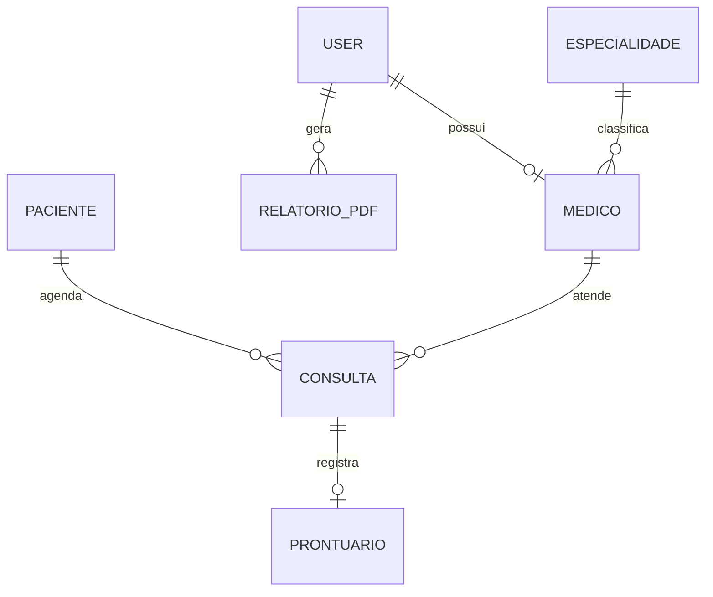

<p align="center">
  
</p>

<h1 align="center">CliniGo</h1>

##  Sobre o projeto
 
O ClinicGo organiza o fluxo de uma clínica em uma API versionada (`/api/v1`). Ele cobre o cadastro de pacientes e médicos, o agendamento de consultas, o registro de prontuários e a geração de relatórios em PDF, com acesso protegido por autenticação.
 
##  Status
 
| Item | Situação |
|---|---|
| Versão atual | **v0.3.0** — autenticação e segurança da API |
| Autenticação (login/logout com Sanctum) | ✅ Concluído |
| Models, migrations, factories e seeders | ✅ Concluído |
| CRUD de pacientes | ✅ Concluído |
| Mensagens em português (pt-BR) | ✅ Concluído |
| Demais CRUDs, autorização por perfil e relatórios | 🔜 Em andamento (veja o [Roadmap](#-roadmap)) |
 
## 🛠️ Tecnologias
 
- **PHP** e **Laravel**
- **MySQL**
- **Laravel Sanctum** (autenticação por token)
- **Composer**
- **Git/GitHub** com Conventional Commits e SemVer
##  Arquitetura
 
A API segue o padrão MVC do Laravel, com camadas separadas para validação e resposta:
 
```
laravel-app/
├── app/
│   ├── Http/
│   │   ├── Controllers/Api/   # AuthController, PacienteController...
│   │   ├── Requests/          # Store/Update...Request (validação)
│   │   └── Resources/         # PacienteResource (formato da resposta)
│   └── Models/                # User, Paciente, Medico, Especialidade,
│                              # Consulta, Prontuario, RelatorioPdf
├── database/
│   ├── migrations/
│   ├── factories/
│   └── seeders/
├── lang/pt_BR/                # traduções (auth, validation, passwords...)
└── routes/api.php             # rotas da API v1
```
 
### Modelo de dados (simplificado)
 

 
> Diagrama simplificado. Ajuste os relacionamentos conforme as migrations do projeto.
 
##  Autenticação e segurança
 
A API usa **Laravel Sanctum**: o usuário faz login, recebe um token e envia esse token nas rotas protegidas.
 
1. Faça login em `POST /api/v1/login` com e-mail e senha.
2. Guarde o token retornado.
3. Envie o token no header das requisições protegidas:
```http
Authorization: Bearer {seu_token}
Accept: application/json
```
 
4. Para sair, use `POST /api/v1/logout`. O token deixa de funcionar.
Rotas protegidas usam o middleware `auth:sanctum`. Sem token válido, a API responde `401 Unauthorized`.
 
> Confira os caminhos exatos das rotas com `php artisan route:list`.
 
##  Como executar
 
**Pré-requisitos:** PHP 8+, Composer e MySQL.
 
```bash
# 1. Clonar o repositório
git clone https://github.com/Firmino03/CliniGo.git
cd CliniGo/laravel-app
 
# 2. Instalar dependências
composer install
 
# 3. Configurar o ambiente
cp .env.example .env
php artisan key:generate
# edite o .env com os dados do seu banco MySQL
 
# 4. Criar tabelas e dados iniciais (inclui usuário admin e especialidades)
php artisan migrate --seed
 
# 5. Iniciar o servidor
php artisan serve
```
 
A API fica disponível em `http://localhost:8000/api/v1`.
 
##  Testes
 
```bash
php artisan test
```
 

##  Roadmap
 
- [x] Models, migrations, factories e seeders
- [x] Autenticação com Sanctum (login e logout)
- [x] CRUD de pacientes
- [x] Traduções em pt-BR
- [ ] Autorização por perfil (admin, médico, paciente) com Policies
- [ ] CRUDs de médicos, especialidades, consultas e prontuários
- [ ] Regras de agendamento (sem conflito de horário, data futura, status da consulta)
- [ ] Relatórios em PDF
- [ ] Rate limiting no login, CORS e tratamento padronizado de erros
- [ ] Testes automatizados (Feature tests)
- [ ] Documentação da API (Scribe ou Swagger)
- [ ] Front-end consumindo a API
##  POO aplicada ao projeto
 
O ClinicGo também serve como laboratório de **Programação Orientada a Objetos**, com base no curso [POO com Java 25 LTS](https://github.com/adrianohmf/POO-com-Java-25LTS). Os conceitos são aplicados em PHP/Laravel e, futuramente, em um serviço Java para relatórios.
 
| Conceito | Aplicação no ClinicGo |
|---|---|
| **Classes e objetos** | `Paciente`, `Medico` e `Consulta` modelam o domínio. Factories e seeders criam vários objetos. |
| **Atributos e métodos** | Métodos como `cancelar()` na consulta e constantes para os status. |
| **Construtores** | *Constructor promotion* em DTOs e Services (PHP); `records` para DTOs no serviço Java. |
| **Encapsulamento** | `$fillable` e `$hidden` nos models, *accessors/mutators* e visibilidade `private`/`protected` nas Services. |
| **Herança** | Comparação entre composição (`User` com `Medico`) e herança (`Usuario` → `Medico`, `Paciente`). |
| **Polimorfismo** | Notificações (e-mail, SMS, WhatsApp) com a mesma chamada e implementações diferentes. |
| **Classes abstratas e interfaces** | `RelatorioGenerator` com `PdfRelatorio` e `CsvRelatorio`; `ConsultaRepositoryInterface`. |
| **Coleções (ArrayList)** | `Collection` do Laravel para filtrar e ordenar a agenda. |
| **HashSet e HashMap** | Horários ocupados sem repetição e agrupamento de consultas por especialidade nos relatórios. |
 
### Ideia futura: serviço de relatórios em Java
 
Um microsserviço **Spring Boot** (`relatorios-service`) que consome a API com o token do Sanctum e gera os PDFs, usando interfaces e polimorfismo:
 
```java
public interface RelatorioGenerator {
    byte[] gerar(List<Consulta> consultas);
}
 
public class PdfRelatorio implements RelatorioGenerator { /* ... */ }
public class CsvRelatorio implements RelatorioGenerator { /* ... */ }
```
 ## Aviso
 
Todos os dados são fictícios (Faker). Este é um MVP de estudo e não deve ser usado com dados reais de pacientes. Dados pessoais e de saúde são sensíveis pela LGPD: num sistema real, esses campos teriam criptografia e controle de acesso rigoroso.

##  Autora
 
**Karolayne Firmino**
[LinkedIn](https://www.linkedin.com/in/karolayne-firmino) · [GitHub](https://github.com/Firmino03)
 
